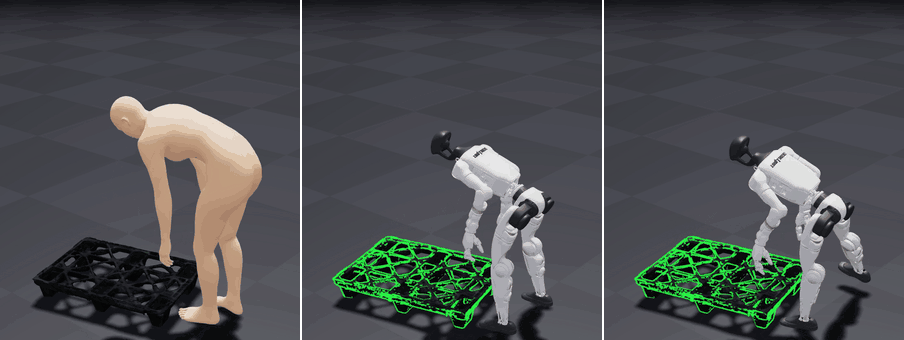
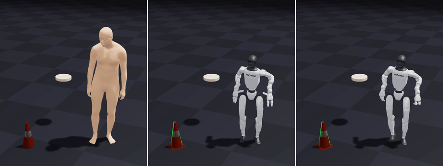
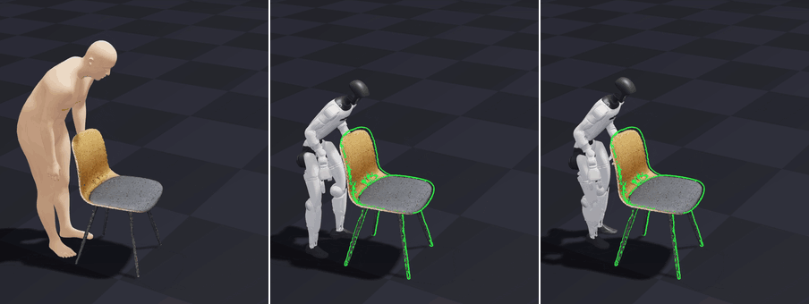

<h1 align="center">DexDuet on the V2D Challenge</h1>
<p align="center">Unitree G1 + Dex3 · NVIDIA FlashCHORD · <a href="https://github.com/HaoranZhangumich/DexDuet">main DexDuet repository</a></p>
<p align="center"><b>2nd place, V2D Challenge Track 2</b> · <a href="https://github.com/RCL-Robotics/nv-v2d-hoi">challenge implementation for all three tiers</a></p>

<p align="center">
  <br>
  <br>
  <br>
  <sub>Human reference · CHORD (PPO) · DexDuet, same training budget</sub>
</p>

## Results

<sub>30 Tier-1 episodes · official evaluator · at most 1.97 B environment steps per episode for every method</sub>

| | ADD-AUC ↑ | SP-SR ↑ | MP-SR ↑ | MPPE (cm) ↓ | Contact-AUC ↑ |
|---|---|---|---|---|---|
| CHORD (PPO)\* | 39.8 | 53.3 | 15.8 | 14.85 | 16.0 |
| DexDuet w/o interaction rewards | 76.2 | 83.3 | 71.7 | **11.47** | 66.6 |
| **DexDuet** | **77.4** | **85.0** | **75.8** | 12.19 | **72.6** |

<sub>Each value is the mean over episodes of four evaluator runs; [DETAILS](docs/DETAILS.md#results) gives the spread
over runs and every episode. Contact-AUC leaves out episode 29, where the human never holds the object.<br>
\*On episode 07, CHORD (PPO) is trained with NVIDIA's code plus a guard that resets a simulated world whose state
becomes non-finite (14 resets in 20,000 iterations).</sub>

## Reproduce

```bash
bash reproduce/prepare_data.sh --gpus 0,1,2,3                          # Tier-1 inputs
bash reproduce/download_checkpoints.sh                                 # released checkpoints (Hugging Face)
bash reproduce/run_all.sh --from-release checkpoints --gpus 0,1,2,3    # evaluate them -> table above
bash reproduce/run_all.sh --gpus 0,1,2,3 --per-gpu 2                   # or train all three methods from scratch
```

[Step by step](reproduce/README.md) · [What DexDuet changes in FlashCHORD](docs/DETAILS.md) ·
[Checkpoints](https://huggingface.co/oldTOM/dexduet-v2d-checkpoints)

Not included here: the V2D Challenge data and submission kit, NVIDIA's video_to_data checkout, and the robot meshes and
SONIC whole-body policy (`reproduce/setup_assets.sh` takes them from that checkout). [Setup](reproduce/README.md#setup)
lists what you need.

## License

Built on NVIDIA's [FlashCHORD](https://github.com/nvidia-isaac/video_to_data) (commit `8c778f9`). Code under Apache-2.0,
documentation under CC-BY-4.0: see [LICENSE](LICENSE), NVIDIA's license file at that commit. DexDuet's additions are
copyright the DexDuet authors, and NVIDIA's files that DexDuet modifies are marked; [NOTICE](NOTICE) lists them and the
parts ported from [DexDuet](https://github.com/HaoranZhangumich/DexDuet) (MIT). The changes to NVIDIA's code are
described in [docs/DETAILS.md](docs/DETAILS.md).
