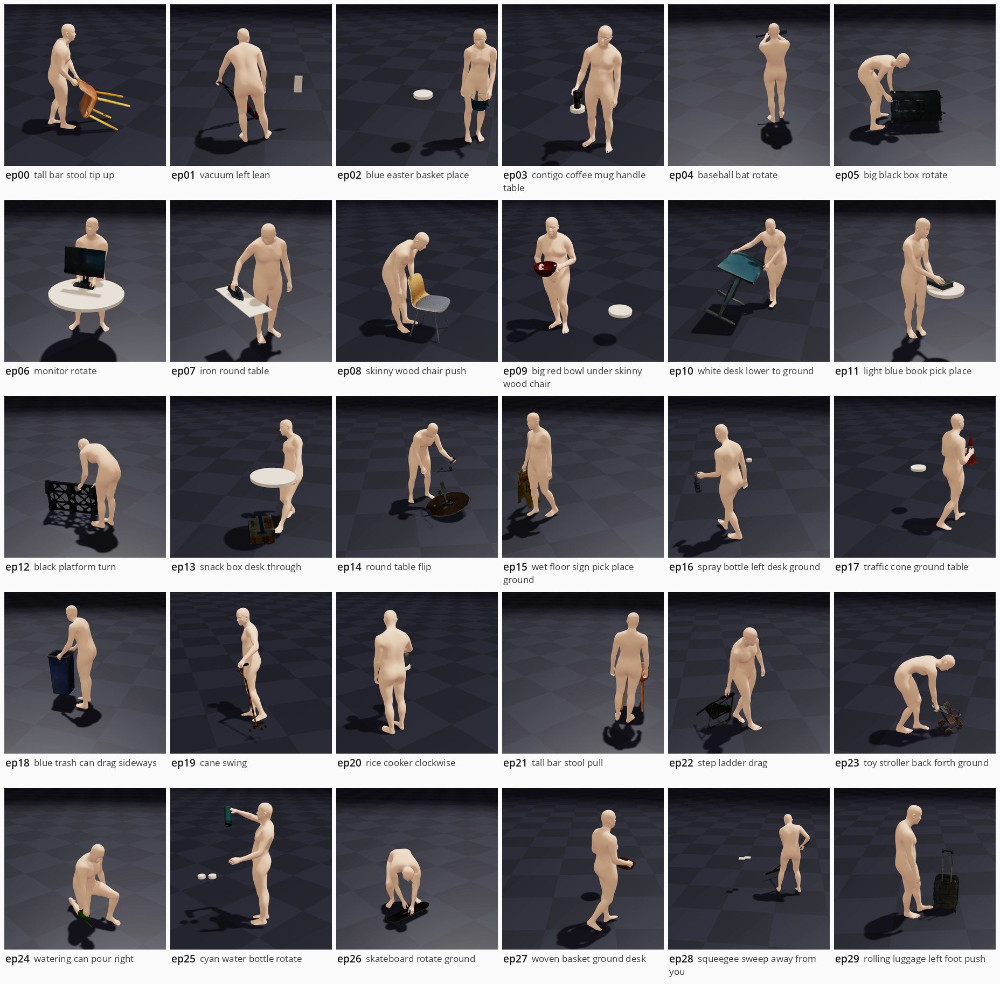

# DexDuet on the V2D Challenge: details

The [README](../README.md) has the overview, the results and the commands; this page has the rest.

- [Tasks](#tasks)
- [What DexDuet adds](#what-dexduet-adds)
- [Methods compared](#methods-compared)
- [Results](#results) ([per episode](#per-episode))
- [Rollouts](#rollouts)
- [Repository layout](#repository-layout)
- [Names in code and configs](#names-in-code-and-configs)
- [FlashCHORD](#flashchord)

## Tasks

The 30 Tier-1 episodes as human references (SOMA body mesh, object at its reference pose), middle frame of each clip,
no policy shown; [animated version](../media/tasks_overview.gif) (whole clips at 2x simulated real time).

## What DexDuet adds

The task: a humanoid must reproduce a human demonstration of moving an object, from video-derived human and object
motion. The G1 positions the Dex3 hands with its arms. The challenge's official evaluator runs the policy from the first
frame and measures how closely the object follows its demonstrated path.

DexDuet changes four things in FlashCHORD's PPO recipe. Observations, termination and the PPO settings stay as in the
challenge's recipe, because the evaluator requires its observation layout.

1. **Per-hand policies.** Each arm and hand is controlled by its own policy, the two hand policies share their
   parameters and observe each other, and a third policy controls the legs and waist. For evaluation, the trained
   network is exported to the challenge's standard policy format and checked to give the same actions.
   Code: `src/flash_chord/training/ppo/coordinate/` (`network.py`, `per_group.py`, `layout.py`, `export.py`).
2. **Assisted reference-state initialization (A-RSI).** Training episodes start at many points of the demonstration,
   not only at its first frame. The demonstration is split into segments, and each segment gets its own level of
   assistance: a controller that pulls the object toward its demonstrated pose. A segment's assistance is lowered
   when episodes that start there succeed and kept where they fail. Episodes start from states the policy reached
   earlier, more often in the segments where it fails, and a quarter of them start at the first frame. Training
   stops a fixed number of iterations after all assistance is gone, or at the cap of 20,000 iterations.
   Code: `src/flash_chord/lifecycle/rsi/`, `src/flash_chord/lifecycle/rsi_reset.py`, config `reset/recon_body_rsi.yaml`.
3. **Object-tracking reward.** A reward for keeping the object at its demonstrated position and orientation.
   Code: term `object_task` in `src/flash_chord/objectives/recon_body.py`.
4. **Two interaction rewards** that compare each robot hand with the human hand, relative to the object:
   - *hand graph*: palm direction, finger directions and fingertip gaps;
   - *hand-object contact*: for the palm, thumb, index and middle finger, the distance to the object and the closest
     point on it.

   Code: `src/flash_chord/objectives/dexduet.py`; the human targets are computed once per episode by
   `scripts/dexduet/` (`soma_hands.py`, `build_targets.py`, `region_points.py`). Their weights keep the ratio to the
   object-tracking reward that DexDuet uses on the DexMachina suite. The Dex3 hand has three fingers (thumb, index,
   middle), so both rewards use these three, its palm normal is a fixed axis of the palm link calibrated once per
   episode to the human palm normal, its palm direction points to the midpoint of the index and middle bases, and the
   human fingertip gaps are scaled by 1.5, the Dex3 retargeting scale.

DexDuet's training code also guards against non-finite physics: a simulated world whose state becomes non-finite is
reset and kept out of the observation normalizer (`src/flash_chord/runtime/nonfinite.py`,
`src/flash_chord/training/README.md`). With finite values it changes nothing. NVIDIA's code has no such guard.

Only this repository's experiment configs switch the four additions above on: `g1_recon_body_coord_rsi_r2_dexduet` all
four, `g1_recon_body_coord_rsi_r2` all but the two interaction rewards; the intermediate experiments listed in
[Names in code and configs](#names-in-code-and-configs) switch on one or two of them. The defaults of the code and of
the config groups leave them off, as do NVIDIA's experiments, such as `g1_recon_body_ppo`; `train.yaml` selects
DexDuet's experiment, so `train_rl.py` without `experiment=` runs DexDuet (see [FlashCHORD](#flashchord)). The paper's
CHORD (PPO) runs use NVIDIA's code itself, not this tree; on episode 07 a separate guard is added to it (see
[Methods compared](#methods-compared)). The first commit (`074a658`) is NVIDIA's code unchanged;
`git diff 074a658 HEAD -- src scripts tests` shows every change.

## Methods compared

Every method is trained once per episode with seed 42 on the same 30 Tier-1 episodes, for at most
**1,966,080,000 environment steps** (20,000 iterations x 4,096 worlds x 24 steps), and evaluated with the challenge's
official evaluator.

| Method | Code | Recipe |
|---|---|---|
| **DexDuet** | this repository | `experiment=g1_recon_body_coord_rsi_r2_dexduet`: all four additions above |
| **DexDuet without interaction rewards** | this repository | `experiment=g1_recon_body_coord_rsi_r2`: the same without the two interaction rewards |
| **CHORD (PPO)** | NVIDIA's official code, unmodified; episode 07 with a non-finite guard (below) | `experiment=g1_recon_body_ppo`; its default budget is the one above |

DexDuet's runs may stop before 20,000 iterations (10 of the 30 did): a fixed number of iterations after A-RSI has
withdrawn all assistance. The runs of DexDuet without interaction rewards were started with the experiment's default
`training.max_iterations=45000`, which their checkpoints' stored configuration shows, and the checkpoint evaluated and
released is the one at 20,000 iterations, or the final one where the run stopped earlier by the same rule (9 of the
30). `max_iterations` only bounds the training loop, so up to that checkpoint these runs train as with
`training.max_iterations=20000`, which `reproduce/train.sh` passes.

**CHORD (PPO), episode 07.** On this episode, the physics state of a simulated world occasionally becomes non-finite
during training, and NVIDIA's trainer has no check for it. CHORD (PPO) on episode 07 is therefore trained with NVIDIA's
code plus a guard that resets a simulated world whose state becomes non-finite
([`reproduce/patches/chord_ppo_nonfinite_guard.diff`](../reproduce/patches/chord_ppo_nonfinite_guard.diff)); it reset
14 worlds in 20,000 iterations. After each environment step (after its physics substeps), the guard clears the solver
accelerations of such a world and ends its episode with zero reward, so the environment resets it; worlds with finite
states are not changed. Config,
budget and seed are the same as for the other episodes, and the policy is evaluated with NVIDIA's unmodified code like
every other one. The other 29 CHORD (PPO) runs use NVIDIA's code unchanged.

## Results

30 Tier-1 episodes, G1 + Dex3. ADD-AUC, SP-SR, MP-SR and Contact-AUC in %, MPPE in cm. Steps: environment steps per
episode, in billions.

| Method | Steps | ADD-AUC ↑ | SP-SR ↑ | MP-SR ↑ | MPPE ↓ | Contact-AUC ↑ |
|---|---|---|---|---|---|---|
| CHORD (PPO) | 1.97 | 39.8 ± 0.3 | 53.3 ± 0.0 | 15.8 ± 5.0 | 14.85 ± 1.29 | 16.0 ± 1.1 |
| DexDuet without interaction rewards | 1.70-1.97 (mean 1.92) | 76.2 ± 0.3 | 83.3 ± 0.0 | 71.7 ± 1.9 | **11.47 ± 0.33** | 66.6 ± 2.3 |
| **DexDuet** | 1.70-1.97 (mean 1.91) | **77.4 ± 0.9** | **85.0 ± 1.9** | **75.8 ± 3.2** | 12.19 ± 0.93 | **72.6 ± 0.8** |

- Each value is the mean over episodes of the mean of four evaluator runs (the evaluator is not deterministic).
  Contact-AUC is computed from four further runs.
- ± is the spread over these four runs: the k-th run of every episode gives one mean over the episodes, and ± is the
  standard deviation (n - 1) of these four means. It shows how much a value moves from one set of evaluator runs to the
  next; it is not a spread over episodes or training seeds (each method is trained once per episode).
- n = 30 episodes, and 29 for Contact-AUC: in episode 29 the human never holds the object.
- CHORD (PPO) on episode 07 is trained with NVIDIA's code plus a guard that resets a simulated world whose state becomes
  non-finite (14 resets in 20,000 iterations; see [Methods compared](#methods-compared)).
- The challenge leaderboard also lists an entry of CHORD with ADD-AUC 51.0, SP-SR 70.0, MP-SR 20.0 and MPPE 17.74;
  its training budget is not published and its policy is not released.

Paired over episodes, DexDuet minus each method (95 % bootstrap CI over episodes, `reproduce/summarize.py`):

| Compared with | n | ADD-AUC | MP-SR | Contact-AUC |
|---|---|---|---|---|
| CHORD (PPO) | 30 (Contact 29) | +37.6 [+30.5, +44.2] | +60.0 [+44.2, +75.0] | +56.6 [+45.4, +67.6] |
| DexDuet without interaction rewards | 30 (Contact 29) | +1.2 [-3.0, +5.7] | +4.2 [-8.3, +16.7] | +6.0 [-2.5, +15.5] |

On ADD-AUC, DexDuet is ahead of CHORD (PPO) on 28 of the 30 episodes and behind on 2 (no ties within 0.5 points;
two-sided sign test p < 0.001).

### Per episode

ADD-AUC (%) of each episode, the mean of four evaluator runs. Task: the episode's sequence name in the challenge data.

| Ep | Task | CHORD (PPO) | DexDuet w/o interaction rewards | DexDuet |
|---|---|---:|---:|---:|
| 00 | tall bar stool tip up | 52.8 | 99.8 | 99.7 |
| 01 | vacuum left lean | 18.6 | 19.2 | 19.6 |
| 02 | blue easter basket place | 44.4 | 91.5 | 90.2 |
| 03 | contigo coffee mug handle table | 52.5 | 97.5 | 98.4 |
| 04 | baseball bat rotate | 13.7 | 13.5 | 13.2 |
| 05 | g1 box rotate | 51.7 | 94.3 | 93.0 |
| 06 | monitor rotate | 58.6 | 88.8 | 91.0 |
| 07 | iron round table | 38.9 | 100.0 | 99.9 |
| 08 | skinny wood chair push | 70.1 | 96.6 | 96.6 |
| 09 | big red bowl under skinny wood chair | 23.0 | 45.1 | 82.1 |
| 10 | white desk lower to ground | 26.9 | 75.2 | 74.8 |
| 11 | light blue book pick place | 35.2 | 86.8 | 93.2 |
| 12 | black platform turn | 45.3 | 96.3 | 96.0 |
| 13 | snack box desk through | 49.3 | 81.9 | 56.8 |
| 14 | round table flip | 42.0 | 66.9 | 73.9 |
| 15 | wet floor sign pick place ground | 46.6 | 93.6 | 77.8 |
| 16 | spray bottle left desk ground | 55.0 | 96.0 | 94.2 |
| 17 | traffic cone ground table | 40.3 | 92.6 | 93.6 |
| 18 | blue trash can drag sideways | 45.7 | 98.2 | 97.2 |
| 19 | cane swing | 12.3 | 15.1 | 16.2 |
| 20 | rice cooker clockwise | 45.5 | 97.1 | 92.6 |
| 21 | tall bar stool pull | 28.3 | 33.5 | 25.3 |
| 22 | step ladder drag | 53.6 | 95.1 | 92.2 |
| 23 | toy stroller back forth ground | 47.0 | 98.4 | 97.7 |
| 24 | watering can pour right | 33.7 | 62.5 | 99.8 |
| 25 | cyan water bottle rotate | 13.0 | 26.7 | 43.4 |
| 26 | skateboard rotate ground | 49.3 | 99.5 | 99.3 |
| 27 | woven basket ground desk | 38.8 | 95.8 | 99.4 |
| 28 | squeegee sweep away from you | 17.2 | 45.9 | 48.1 |
| 29 | rolling luggage left foot push | 44.0 | 82.9 | 66.4 |
| | **Mean** | **39.8** | **76.2** | **77.4** |

Contact-AUC (%) of each episode, from four further evaluator runs. In episode 29 the human never holds the object, so
it has no Contact-AUC.

| Ep | Task | CHORD (PPO) | DexDuet w/o interaction rewards | DexDuet |
|---|---|---:|---:|---:|
| 00 | tall bar stool tip up | 33.8 | 93.7 | 97.3 |
| 01 | vacuum left lean | 3.6 | 5.9 | 7.3 |
| 02 | blue easter basket place | 13.2 | 94.4 | 92.2 |
| 03 | contigo coffee mug handle table | 25.3 | 72.7 | 98.5 |
| 04 | baseball bat rotate | 0.0 | 0.0 | 0.0 |
| 05 | g1 box rotate | 29.8 | 59.8 | 59.6 |
| 06 | monitor rotate | 31.2 | 98.8 | 97.9 |
| 07 | iron round table | 6.5 | 99.4 | 99.5 |
| 08 | skinny wood chair push | 41.0 | 82.5 | 92.5 |
| 09 | big red bowl under skinny wood chair | 0.3 | 24.0 | 95.1 |
| 10 | white desk lower to ground | 12.9 | 48.0 | 32.3 |
| 11 | light blue book pick place | 11.4 | 44.4 | 94.9 |
| 12 | black platform turn | 25.2 | 84.7 | 89.5 |
| 13 | snack box desk through | 19.9 | 82.1 | 31.8 |
| 14 | round table flip | 38.1 | 62.7 | 75.8 |
| 15 | wet floor sign pick place ground | 9.1 | 98.0 | 72.3 |
| 16 | spray bottle left desk ground | 9.3 | 96.2 | 98.7 |
| 17 | traffic cone ground table | 7.9 | 95.4 | 95.9 |
| 18 | blue trash can drag sideways | 25.0 | 94.3 | 94.9 |
| 19 | cane swing | 0.0 | 4.6 | 5.7 |
| 20 | rice cooker clockwise | 37.9 | 92.3 | 90.6 |
| 21 | tall bar stool pull | 6.4 | 22.8 | 11.3 |
| 22 | step ladder drag | 19.7 | 97.4 | 96.2 |
| 23 | toy stroller back forth ground | 20.1 | 96.7 | 97.1 |
| 24 | watering can pour right | 5.0 | 19.6 | 99.9 |
| 25 | cyan water bottle rotate | 3.1 | 30.7 | 45.7 |
| 26 | skateboard rotate ground | 21.6 | 95.7 | 93.3 |
| 27 | woven basket ground desk | 4.1 | 98.2 | 99.9 |
| 28 | squeegee sweep away from you | 3.3 | 37.5 | 40.2 |
| 29 | rolling luggage left foot push | no hold | no hold | no hold |
| | **Mean** | **16.0** (n = 29) | **66.6** (n = 29) | **72.6** (n = 29) |

**Metrics.** The first four come from the challenge's evaluator. ADD-AUC is the area under the accuracy curve of
the mean distance between object points at the simulated and demonstrated pose, for thresholds of 1 to 9 cm.
SP-SR counts an episode as a success if its object errors, averaged over the episode, are at most 10 cm and 0.5 rad;
MP-SR if they are below 3 cm and 30°. In the evaluator's result files SP-SR is `spider_sr_uncentered`, the key of the
challenge leaderboard; `chord_sr` there is CHORD's own success rate and is not SP-SR. MPPE is the mean error of six points placed 5 cm from the object's origin along its axes. Contact-AUC measures whether each robot
hand keeps the human's contacts: in short windows in which a human hand holds the object without sliding, the matching
robot hand must touch the object (one of its surface points within 5 mm of it) and the object must not slide against
that hand; windows in which the object is lost (more than 5 cm off its path) count as failures. The paper's
supplementary material defines it in full. On V2D it uses 64 surface points on each of the eight collision links of
each Dex3 hand and the 2,847 vertices of each SOMA-X human hand.

**Hardware and time.** DexDuet was trained on NVIDIA RTX PRO 6000 Blackwell GPUs (96 GB), about 10 h per run with two
or three runs sharing a GPU. CHORD (PPO) was trained on NVIDIA H200 GPUs, up to about 11 h per run. One evaluator run
takes under a minute; scoring Contact-AUC takes a few minutes of one CPU core per method and episode.

## Rollouts

The README shows the human reference, CHORD (PPO) and DexDuet on three Tier-1 episodes, from the checkpoints of the
table above.

- **What is shown.** Each robot panel is one new run of the challenge's official evaluator (one world, start at frame 0,
  deterministic policy, whole episode) on the policy the table scored: DexDuet's final checkpoint (`final.json`;
  iteration 20,000 for episodes 12 and 17, 17,255 for episode 8) and CHORD (PPO)'s `model_20000`, both converted to the
  official policy format as `reproduce/evaluate.sh` does. The green outline is the reference object pose. The left
  panel is the human reference (SOMA body mesh, object at its reference pose). All three panels use the same camera,
  fitted to the reference motion alone, and the same crop.
- **Episodes.** Eligible: the episodes in which DexDuet's ADD-AUC is at least its median over the 30 episodes (92.4);
  15 episodes. From these, one per action: a flip (episode 12, the only one), a pick-and-place (episode 17) and a push
  or drag (episode 8). Where several episodes share an action, the one with the largest object is shown. CHORD (PPO)'s
  results played no part in the choice; episode 8 is its best episode.
- **Cut.** From 1 s before the reference object starts to move to 1 s after it comes to rest (2 cm thresholds, rounded
  to 0.5 s): episode 12 shows 3.0-13.0 s of 14.0 s, episode 17 1.0-7.5 s of 8.8 s, episode 8 7.0-13.0 s of 14.2 s.
- **Speed.** Simulated real time at 15 frames per second, taken from the 50 Hz control steps. The evaluator advances
  the reference by one frame of the 30 fps recording per control step, so the motion plays about 1.67x faster than the
  human recording.
- **Check.** Each rollout's ADD-AUC is within 2 points of the scored mean, with the same SP-SR and MP-SR as all four scored
  runs. Rendered vs scored ADD-AUC (%), CHORD (PPO) / DexDuet: episode 12 43.5 vs 45.3 / 96.1 vs 96.0, episode 17
  40.0 vs 40.3 / 91.9 vs 93.6, episode 8 71.5 vs 70.1 / 96.5 vs 96.6.

## Repository layout

| Path | Content |
|---|---|
| `reproduce/` | Scripts that reproduce the V2D results (data, training, evaluation, Contact-AUC, summary) |
| `src/flash_chord/` | FlashCHORD with DexDuet's additions (see [What DexDuet adds](#what-dexduet-adds)) |
| `src/flash_chord/configs/experiment/g1_recon_body_coord_rsi_r2_dexduet.yaml` | DexDuet's experiment |
| `scripts/dexduet/` | DexDuet's human targets and the Contact-AUC recorder and scorer |
| `scripts/track2/` | Export and official evaluation of trained runs (`eval_all.py`); `record_eval_actions.py` is used by the export test |
| `tests/` | NVIDIA's tests plus tests of the additions (`tests/coordinate`, `tests/rsi`, `tests/objectives/test_dexduet_*`) |

## Names in code and configs

What the parts of this page are called in the code, the configs and the command lines.

| Name on this page | In code and configs |
|---|---|
| DexDuet | experiment `g1_recon_body_coord_rsi_r2_dexduet`; method `dexduet` in `reproduce/` |
| DexDuet without interaction rewards | experiment `g1_recon_body_coord_rsi_r2`; method `dexduet_no_interaction_rewards` |
| CHORD (PPO) | NVIDIA's experiment `g1_recon_body_ppo`; method `chord_ppo` |
| per-hand policies | `training.coordinate` (`CoordinateConfig`), `training/ppo/coordinate/`; "coordinated actor" in comments |
| A-RSI | `reset/recon_body_rsi.yaml`, `lifecycle/rsi/`, `lifecycle/rsi_reset.py` |
| object-tracking reward | objective term `object_task` |
| hand graph / hand-object contact rewards | objective terms `hand_graph`, `ho_contact` |
| export to the official policy format | `training/ppo/coordinate/export.py` |
| intermediate experiments, kept because the config tests build on them | `g1_recon_body_rsi` (A-RSI only), `g1_recon_body_coord` (per-hand policies only), `g1_recon_body_coord_rsi` (both), `g1_recon_body_coord_rsi_wide` (both, with the per-hand actor size of DexDuet's two experiments) |
| this repository's code, as opposed to NVIDIA's official runtime | "DEV" in comments and help texts (`scripts/track2/eval_all.py --code`) |
| a folder of checkpoints from NVIDIA's own learner, which need no export | `scripts/track2/eval_all.py --arm B0` |

## FlashCHORD

This repository contains NVIDIA's FlashCHORD runtime from `video_to_data@8c778f9` with DexDuet's additions. NVIDIA's
README for FlashCHORD (container setup, viewers, replay and its own training examples) is
[in NVIDIA's repository](https://github.com/nvidia-isaac/video_to_data/blob/8c778f905cb35f76f8e6cd6e2ea486da4fb9e0ef/robotic_grounding/flash_chord/README.md). FlashCHORD also ships other robots (floating Sharpa hands, Vega); their code, assets
and tests are kept unchanged so that the diff to NVIDIA's code stays small, but this work uses only the Unitree G1
with Dex3 hands. The training entry point `train_rl.py` defaults to DexDuet's experiment on G1 + Dex3, and every
command in `reproduce/` names its experiment explicitly.
